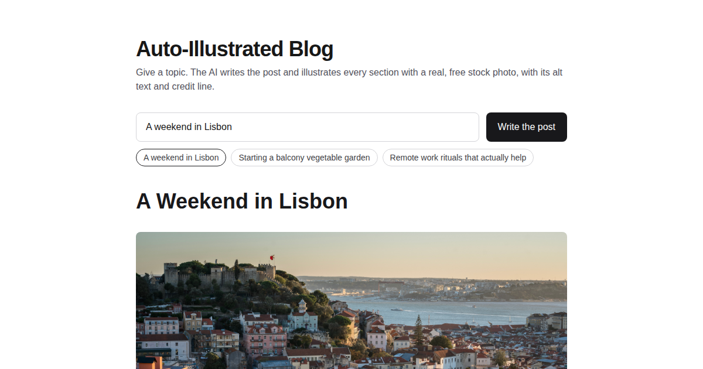

# Auto-Illustrated Blog

Give a topic. The [AI SDK](https://ai-sdk.dev) writes a blog post and illustrates every section
with a real, free stock photo found by [Pexafy](https://pexafy.com), with its alt text and credit
line.



[](https://vercel.com/new/clone?repository-url=https%3A%2F%2Fgithub.com%2FPexafy%2Fauto-illustrated-blog&env=PEXAFY_API_KEY,ANTHROPIC_API_KEY&envDescription=A%20free%20Pexafy%20API%20key%20and%20an%20Anthropic%20API%20key&envLink=https%3A%2F%2Fpexafy.com%2Fdashboard%2Fapi-keys%2Fcreate%2F&project-name=auto-illustrated-blog&repository-name=auto-illustrated-blog)

## How it works

[`app/api/write/route.ts`](app/api/write/route.ts) streams the post with `streamText`. The model
gets one tool, `searchPhotos` from [`pexafy-ai-sdk`](https://www.npmjs.com/package/pexafy-ai-sdk):

1. It searches a header photo and one photo per section, each described as a visible scene.
2. It writes the post in Markdown and inserts each photo with the `url`, `alt_text` and `credit`
   the tool returned.

The page renders the Markdown as it streams. Photos come from Unsplash, Pexels, Pixabay and other
free libraries.

## Run it locally

Requires Node.js 22 or later.

```bash
cp .env.example .env.local   # then fill in both keys
npm install
npm run dev
```

| Variable | Where to get it |
|---|---|
| `PEXAFY_API_KEY` | Free, no card: [pexafy.com/dashboard/api-keys/create](https://pexafy.com/dashboard/api-keys/create/) |
| `ANTHROPIC_API_KEY` | [console.anthropic.com](https://console.anthropic.com/) |

The example uses Claude Haiku 4.5. Any AI SDK provider works: change the `model` line in the route.

## Credits

On Pexafy's free plan, keep the credit line next to each photo you publish. The post already
places it under every photo.

## License

MIT
